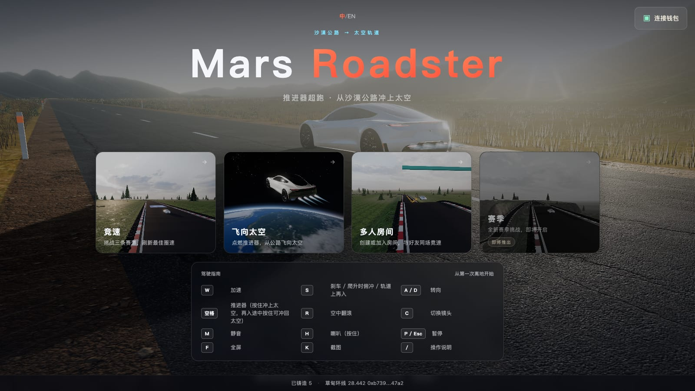
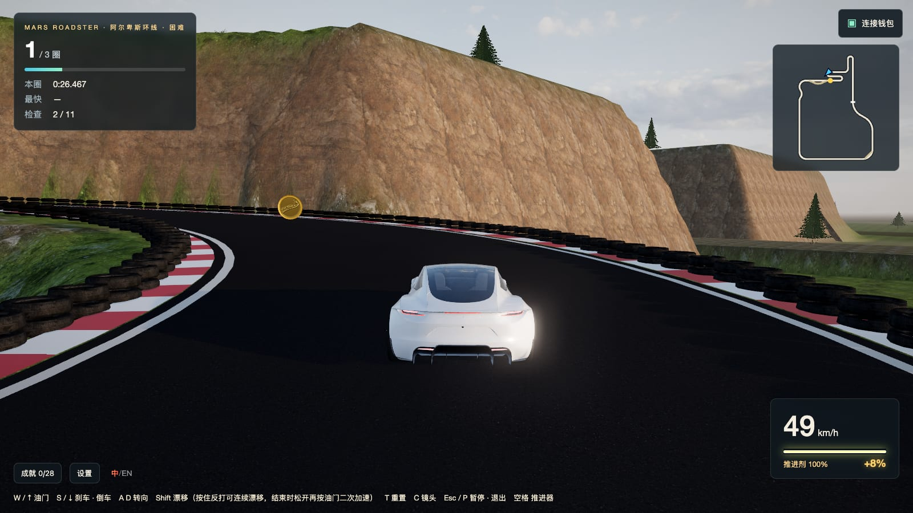
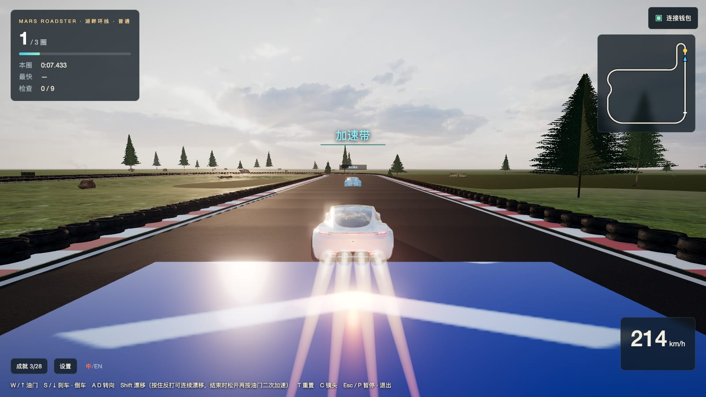
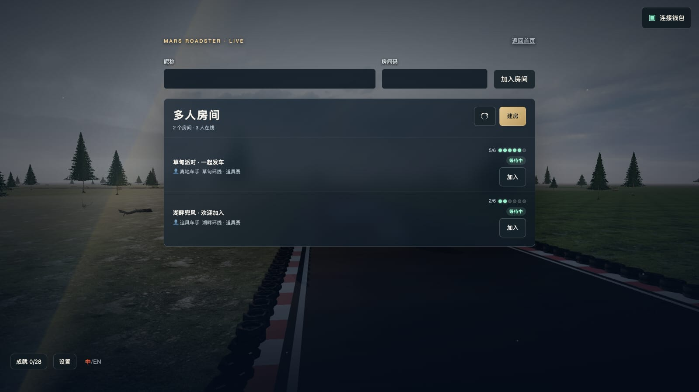
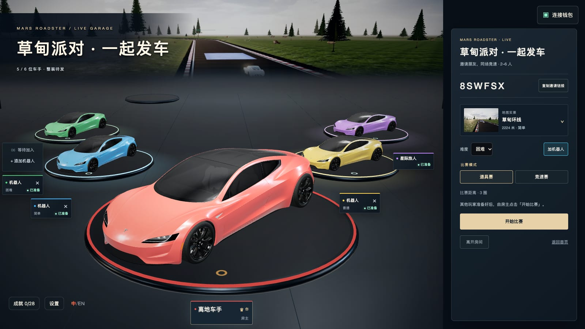
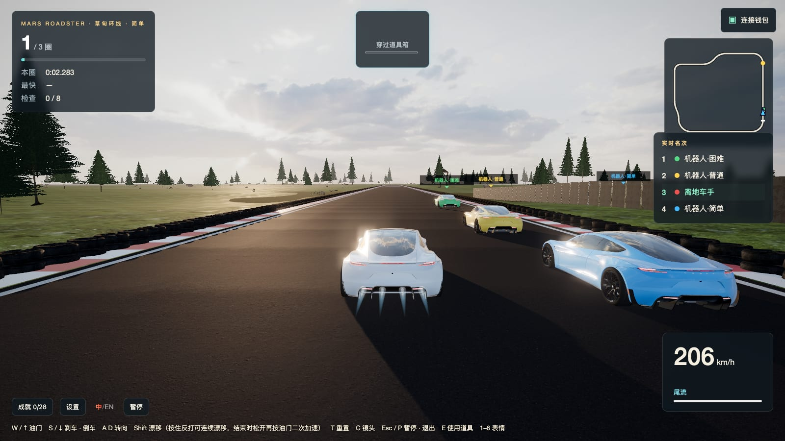
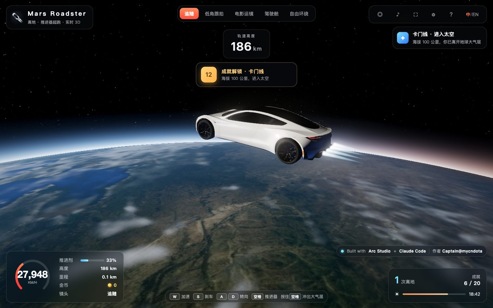
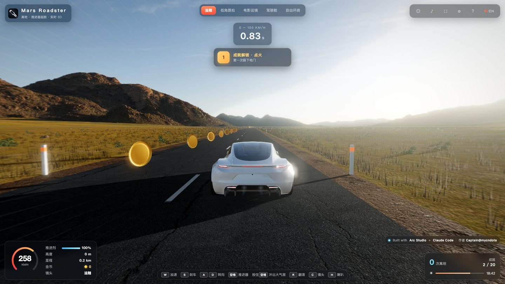
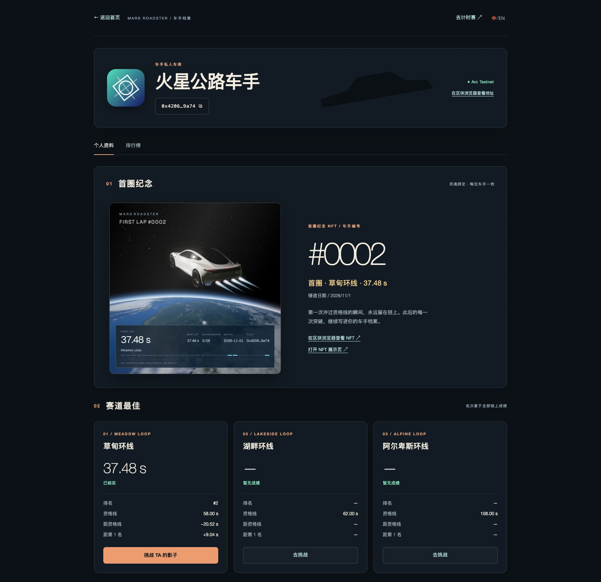

<p align="center"></p>

<h1 align="center">Mars Roadster（离地）</h1>

<p align="center">
  推进器超跑：三条赛道计时赛、多人道具赛，从沙漠公路冲上太空 🚀<br>
  钱包可选，用来把首圈成绩铸造成链上纪念 NFT。<br>
  <sub>A browser 3D thruster racer: three circuits, multiplayer item races, and a desert-to-orbit adventure, with optional onchain first-lap NFTs.</sub>
</p>

<p align="center"><b>▶ 在线试玩：<a href="https://mars-roadster.vercel.app">mars-roadster.vercel.app</a></b></p>



## 模式

### 竞速

草甸、湖畔、阿尔卑斯三条闭环赛道，跑完三圈，挑战最快单圈。弯道漂移蓄力、出弯释放加速，跟车可借尾流；阿尔卑斯还可点燃推进器飞越断桥，吃金币补充燃料。多人房间可加入简单、普通、困难电脑对手。



### 影子赛

和自己的最佳录像，或排行榜前 10 名中已核实且有录像的影子同场，查看实时时间差。影子不参与碰撞；上传的录像会由服务端重新模拟，核实圈速后供其他车手挑战。



### 多人房间

从房间列表加入，或自己建房，可加 4 位数字密码。大厅里选图、准备，由房主发车；人数不足可用机器人补位。支持竞速赛与道具赛，原创道具有导弹、水雷、氮气、护盾。



<p>
  
  
</p>

多人房间需要单独运行 `npm run rooms`。线上默认关闭，构建时设置 `VITE_ROOMS_ENABLED=1` 开启，并提供可访问的房间 WebSocket 服务。`VITE_ROOMS_URL` 指定独立服务地址，未设置时连接同域名 `/rooms`。服务端变量及用途见 [deploy/rooms/README.md](deploy/rooms/README.md)。

### 飞向太空

1. **沙漠公路**：起步 0.8 秒破百，沿弯道吃金币；按空格点燃推进器离地，空中按 R 翻滚。
2. **冲出大气层**：推进剂在 70% 以上时按住空格，手动爬升；突破音障、穿云，越过 100 公里卡门线。松开缓降，按 S 主动俯冲返回。
3. **轨道**：入轨 412 公里，与 2018 年的老前辈和 Starman 擦肩而过；真空里的转向、侧移、翻滚靠姿态喷口。
4. **再入返航**：按 S 再入，穿过等离子火光与云层，对准车道返回公路；再入途中按住空格可以冲回太空。

<p>
  
  
</p>

## 链上纪念

在计时赛跑进资格线，赛后即可选择铸造不可转让（灵魂绑定）的首圈纪念 NFT；之后可把刷新后的最快圈和新增成就上链。游戏本身无需钱包，链上操作使用 Arc 网络，手续费以 USDC 支付。

个人主页汇总专属头像、车手称号、NFT、三条赛道成绩与名次、28 个成就和上链记录；也能打开排行榜，查看其他车手并挑战其影子。



Arc 主网合约：`0xE0D2c19988a6fC90806B56De797Fc4D107946526`。

## 操作

**竞速**（以游戏内提示为准）：

| 按键 | 作用 |
|---|---|
| W / ↑ | 油门 |
| S / ↓ | 刹车、倒车 |
| A / D 或 ← / → | 转向 |
| Shift | 漂移蓄力；按住反打可连续漂移，结束时松开再按油门二次加速 |
| T / Backspace | 重置，罚时 +3 秒 |
| C | 切换镜头 |
| Esc / P | 暂停、退出菜单 |
| 空格 | 推进器，仅阿尔卑斯赛道可用 |
| E | 使用道具，仅多人道具赛 |
| 1–6 | 表情，仅多人房间 |

**飞向太空**：

| 按键 | 作用 |
|---|---|
| W / S | 加速 / 刹车（爬升时俯冲，轨道上再入） |
| A / D | 转向（空中与太空中靠姿态喷口） |
| 空格 | 推进器：轻按离地，按住冲向太空；再入途中按住冲回太空 |
| R | 空中翻滚 |
| C | 切换镜头：追随、低角跟拍、电影运镜、驾驶舱、自由环绕 |
| H / M | 喇叭 / 静音 |
| P 或 Esc | 暂停（暂停菜单里可查看本局成绩并导出分享卡） |
| F / K | 全屏 / 截图 |

手机上有触屏按钮，横屏体验更好。游戏支持中英双语，首次打开跟随浏览器语言，可随时切换；画质支持自动调整。

## 本地运行

需要 Node.js 20.19+ 或 22.12+。

```bash
npm install
npm run dev -- --host 127.0.0.1 --port 8932 --strictPort
npm run build    # 打包到 dist/
npm test         # 全量测试
npm run preview  # 预览打包结果
```

多人房间另开终端运行：

```bash
npm run rooms
```

房间服务默认端口 8933，Vite 已代理 `/rooms`。本地核实、影子存储与 NFT 接口另开终端运行：

```bash
npm run dev:api
```

接口默认监听本机 8934，Vite 代理 `/api`，包含成绩核实、影子下载、NFT 元数据与图片。公开前端配置通过启动终端的进程环境提供；当前 Vite 配置禁用 `.env` 自动加载，修改前端配置后需重启开发服务或重新构建。

| 环境变量 | 用途 |
|---|---|
| `VITE_WALLETCONNECT_PROJECT_ID` | WalletConnect 项目 ID，用于钱包弹窗与手机扫码 |
| `VITE_ARC_NETWORK` | 选择 Arc 网络，默认测试网 |
| `VITE_RACING_ADDRESS` | 对应网络的赛道合约地址，主网需显式配置 |
| `VITE_ROOMS_ENABLED` | 生产构建的多人房间入口开关 |
| `VITE_ROOMS_URL` | 多人房间 ws/wss 服务地址；未设置时使用同域名 `/rooms` |
| `GHOST_STORE` | 录像存储后端；文件模式用于本地联调，默认使用 Blob |
| `BLOB_READ_WRITE_TOKEN` | Blob 存储访问凭据，仅服务端使用 |
| `API_PORT` | 本地接口监听端口，修改时需同步 Vite 代理 |
| `SITE_URL` | NFT 资源链接使用的网站地址 |

文件模式将录像保存在忽略提交的 `.local-data/ghosts/`，适合单进程本地联调。成绩核实还需要服务端签名配置，由服务托管方管理；普通游玩、公开主页和截图不需要签名凭据。

路由与调试参数：

- `/`：首页；`?race`：竞速选图；`?race&room`（或 `?room`）：多人房间。
- `?profile`：个人主页；`?profile&address=<钱包地址>`：查看他人；`?profile&tab=leaderboard`：排行榜。
- `?still=road|chase|lift|space`：飞行模式效果验证镜头。
- `?race&capture&map=easy|normal|hard`：逐帧竞速截图；`?capture`：飞行模式逐帧录制。
- `?nograss`、`?dbg=noblur|nobloom`：关闭草丛、动态模糊或泛光，排查画面。

辅助脚本（先启动所需本地服务）：

- `node scripts/capture-readme.mjs`：采集中文静音 README 截图；需要 Playwright Chrome 与 `sharp`，只读公开数据，不签名、不发交易。
- `node scripts/chain/wallet-smoke.mjs`：钱包弹窗与输入隔离检查；通过 `URL` 指向开发页面，不发送交易。
- `scripts/probe.mjs`：逐帧推进、状态检查与截图。
- `scripts/record.mjs` + `scripts/encode.py`：录制演示视频并合成 MP4。
- `scripts/logo/`：用游戏里的真车模型渲染 LOGO。

## 技术栈

Vite + three.js，游戏使用原生 ES 模块；钱包弹窗由独立 React 根承载，使用 RainbowKit、wagmi、WalletConnect 与 viem；多人房间通过 WebSocket 同步。

| 目录 | 内容 |
|---|---|
| `src/game` | 飞行场景、车辆物理、爬升、入轨、再入、镜头与金币 |
| `src/race` | 三条赛道、确定性模拟、漂移、影子、电脑对手、道具与大厅 |
| `src/chain` | Arc 网络、钱包连接、链上成绩、NFT 与排行榜 |
| `src/profile` | 个人主页、头像、称号、成绩与上链记录 |
| `src/net` | 房间客户端、协议与入口开关 |
| `src/ui` | 首页、暂停菜单与设置 |
| `src/audio` | 动态音乐与合成音效 |
| `src/achievements` | 28 项成就 |
| `src/share` | 本局成绩与分享卡 |
| `src/i18n` | 中英双语词条与切换 |
| `src/mobile` | 手机触控与自适应画质 |
| `server/rooms` | 房间服务、列表、准备、机器人与比赛同步 |
| `api/` | 录像核实、影子存储、NFT 元数据与图片接口 |
| `contracts/` | 首圈纪念 NFT 与赛道成绩合约 |

测试：`npm test`。

## 素材与声明

Built with **Arc Studio** + **Claude Code**。作者：Captain@mycndota。

第三方模型、贴图、音乐的作者与授权见 [CREDITS.md](CREDITS.md)。

本项目为独立的粉丝致敬作品，与 Tesla、SpaceX 无关联。
