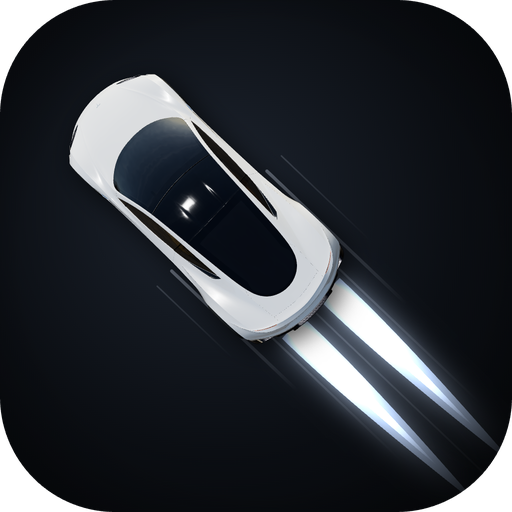
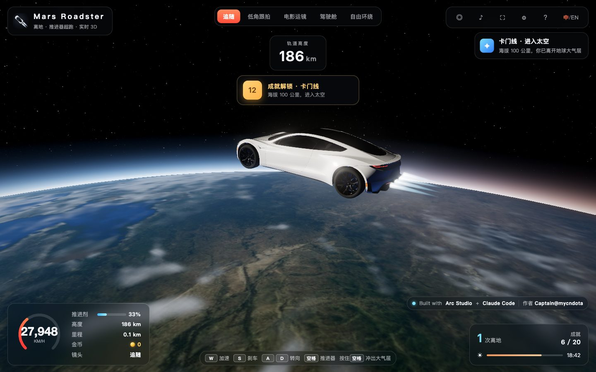
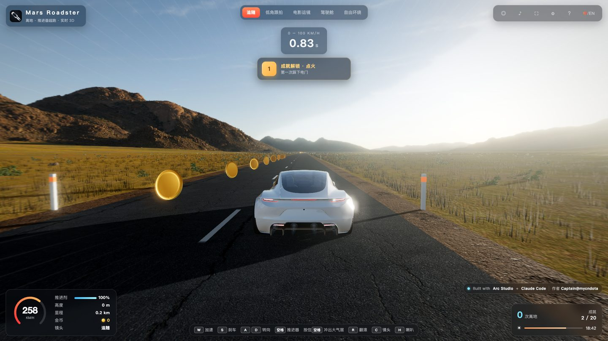

<p align="center"></p>

<h1 align="center">Mars Roadster（离地）</h1>

<p align="center">
  0.8 秒破百，推进器离地，冲破云层、越过卡门线，在轨道上与 2018 年的 Starman 同框 🚀<br>
  <sub>A browser 3D game: drive a thruster Roadster from a desert highway to orbit and back. Free to play, no install, no wallet.</sub>
</p>

<p align="center"><b>▶ 在线试玩：<a href="https://mars-roadster.vercel.app">mars-roadster.vercel.app</a></b></p>



## 玩法

1. **沙漠公路**：起步 0.8 秒破百，在左右交替的弯道上一路吃金币；按空格点燃车底推进器离地，空中按 R 翻滚。
2. **冲出大气层**：推进剂在 70% 以上时按住空格，全程手动爬升。依次经过突破音障（音爆与蒸汽锥）、穿云、云海、平流层天空变暗，越过 100 公里卡门线进入太空。爬升途中松开会缓降，按 S 主动俯冲返回。
3. **轨道**：入轨 412 公里，2018 年被送上太空的老前辈和 Starman 会从车旁擦肩而过。真空里没有空气可借力，转向、侧移、翻滚都靠车身两侧的姿态喷口。
4. **再入返航**：按 S 再入，等离子火光包裹车身，穿云落回沙漠上空，缓降对准车道平稳回到公路。再入途中按住空格可以中止、冲回太空。



## 操作

| 按键 | 作用 |
|---|---|
| W / S | 加速 / 刹车（爬升时俯冲，轨道上再入） |
| A / D | 转向（空中与太空中靠姿态喷口） |
| 空格 | 推进器：轻按离地，按住冲向太空；再入途中按住冲回太空 |
| R | 空中翻滚 |
| C | 切换镜头：追随、低角跟拍、电影运镜、驾驶舱、自由环绕 |
| H / M | 喇叭 / 静音 |
| P 或 Esc | 暂停（暂停菜单里可查看本局成绩并导出分享卡） |
| F / K | 全屏 / 截图 |

手机上有触屏按钮：左侧拖动转向，右侧加速、刹车、推进器、翻滚、切换镜头，横屏体验更好。

## 特色

- **实时 3D、照片级画面**：实拍沙漠全景天空，真车模型，3D 草丛与随太阳光照起伏的地面；NASA 地球贴图与星图，大气层随高度从蓝天过渡到黑色太空。
- **完整往返**：从公路到 412 公里轨道再回到公路，各阶段都可以反向操作，冲上去、掉下来、再冲上去都行。
- **20 项成就**：本局成绩可导出横版或竖版分享卡。
- **中英双语**：第一次打开跟随浏览器语言，右上角「中 / EN」随时切换。
- **画质自适应**：电脑默认极致画质；手机自动档会在卡顿时降档。

## 本地运行

需要 Node.js 20.19 或 22.12 以上（Vite 7 的要求）。

```bash
npm install
npm run dev      # 开发服务器
npm run build    # 打包到 dist/
npm run preview  # 预览打包结果
```

钱包连接使用 RainbowKit + wagmi + WalletConnect，提供紧凑深色钱包选择弹窗，支持浏览器钱包及手机扫码。首次点击连接时才加载钱包界面。

在未提交的 `.env.local` 中配置：

```dotenv
VITE_WALLETCONNECT_PROJECT_ID=your-walletconnect-project-id
```

部署时也需设置该构建环境变量；修改后重新启动 Vite 或重新构建。Arc 网络继续由 `VITE_ARC_NETWORK` 控制，默认测试网。项目 ID 可按本地 arc-lepton 的 `NEXT_PUBLIC_WALLETCONNECT_PROJECT_ID` 配置，勿复制其他私密字段。生产域名需在对应 WalletConnect 项目中允许访问。

钱包交互回归：启动 `npm run dev -- --host 127.0.0.1 --port 8934` 后运行 `node scripts/chain/wallet-smoke.mjs`，检查实际竞速页的钱包弹窗、键盘隔离与取消重试，不发送交易。

添加 `--qr` 可检查真实 WalletConnect 二维码（需要连接其服务），添加 `--mobile` 可验证手机视口；设置 `URL` 可改为检查生产预览。

`package.json` 将 `cuer` 的 `qr` 依赖固定为 `0.5.4`，避免新版本拒绝组件的零边框参数而使扫码界面崩溃；`src/chain/wallet-qr.test.mjs` 覆盖实际二维码渲染。

调试参数（加在地址后面）：

- `?still=road|chase|lift|space`：效果验证镜头
- `?capture`：不自动跑循环，由脚本逐帧推进（录制、测试用）
- `?nograss`、`?dbg=noblur|nobloom`：关闭草丛、动态模糊、泛光，便于排查画面

辅助脚本（先 `npm run dev -- --host 127.0.0.1 --port 8932`）：

- `scripts/probe.mjs`：逐帧推进并打印状态、按时刻截图
- `scripts/record.mjs` + `scripts/encode.py`：逐帧录制演示视频并合成 mp4
- `scripts/logo/`：用游戏里的真车模型渲染 LOGO

## 技术栈

Vite + three.js，游戏使用原生 ES 模块，钱包弹窗由独立 React 根承载。主要目录：

| 目录 | 内容 |
|---|---|
| `src/game` | 场景、车辆物理、飞行流程（爬升、入轨、再入）、镜头、地面与草丛、金币 |
| `src/ui` | 开始页、暂停菜单、设置 |
| `src/audio` | 动态音乐与合成音效 |
| `src/achievements` | 成就系统 |
| `src/share` | 本局成绩与分享卡 |
| `src/i18n` | 中英双语词条与切换 |
| `src/mobile` | 手机触控与自适应画质 |

测试：

```bash
node --test src/share/share.test.mjs src/audio/audio.test.mjs src/i18n/i18n.test.mjs
```

## 素材与声明

Built with **Arc Studio** + **Claude Code**。作者：Captain@mycndota。

第三方模型、贴图、音乐的作者与授权见 [CREDITS.md](CREDITS.md)。

本项目为独立的粉丝致敬作品，与 Tesla、SpaceX 无关联。
